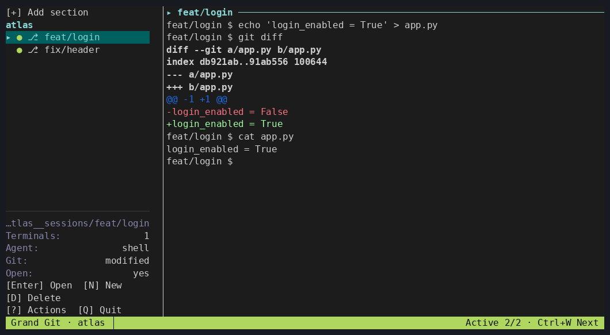

# Grand Git

[Russian](README.ru.md)

**A simple terminal workspace for parallel tasks: Git worktrees, persistent terminals, one dashboard.**

Grand Git (`gg`) keeps the everyday workflow small: create a task, work in its terminal, switch to another task, and stop or remove it when finished. Each Git task has its own worktree, so unfinished changes can stay where they are. Ordinary folders work too, with terminals in place.

Use it when you want a shared view of your projects and running tasks with little setup. Shells work out of the box; startup templates and Codex status are optional. You manage commits, pushes and merges with your usual Git tools.



Create a task, open a second worktree, and switch back with your edits and terminal intact. [Static screenshot](docs/assets/gg-demo.png).

## Install

Grand Git ships binaries for Linux (including WSL2) and macOS on amd64 and arm64. Install **tmux 3.4+** for terminal sessions and **Git 2.36+** for Git projects with v1.0.0. Source builds containing the worktree fix (`fcf9d51`) support Git 2.31+. The installer checks for both tools. Use a non-bare repository for Git tasks.

Run these commands to install the latest stable release in `~/.local/bin`.

```sh
curl -fsSLo install-gg.sh https://github.com/chartyom/grand-git/releases/latest/download/install.sh &&
  sh install-gg.sh
export PATH="$HOME/.local/bin:$PATH"
gg --version
```

To build from a source checkout with **Go 1.26+**, run `go build -o bin/gg ./cmd/gg` and use `./bin/gg`. For a pinned version, manual download, update or removal, see the [installation guide](docs/installation.md).

If `gg` opens Git GUI or reports a missing `gui` command, check for a [shell alias named `gg`](docs/installation.md#if-gg-runs-git-gui).

## Quick start

```sh
gg dashboard                 # open saved folder sections and sessions
```

Press +, choose a directory and confirm with Ctrl+S. On that section, press T for a plain shell or N to create a session. In Git, enter a branch name and press Enter to open the new task in its own worktree. Ctrl+W cycles through the list and terminal panes; Enter opens the selected session. The same gg dashboard process stays open when switching projects.

You can also create tasks from the command line. This example uses a Git working directory with a commit on `main`.

```sh
gg create feat/login         # worktree + background shell
gg create fix/release --base main
gg list
```

New worktrees live at `<project>__sessions/<branch>`. Ignored local files such as `.env` and `node_modules` are copied independently; `--no-copy` skips copying. Outside Git, `gg create [name]` creates a terminal in the current folder. `gg` without a command shows help.

## Dashboard

The sidebar groups sessions under selectable folder sections. Worktrees (`⎇`) and plain terminals (`>_`) share one list in creation order. A single click opens or starts a session; hovering previews details without switching terminals. `●` / `○` indicates running / stopped terminals; `▸` marks the open terminal independently of the highlighted selection. Details show the path, terminal count, agent and Git state.

| In the session list | Key |
| --- | --- |
| Select / open | ↑↓ or J/K / Enter or single click |
| Add a folder section / remove an empty section | + / X |
| New session | N |
| Actions and shortcuts | Right-click, ? or Shift+F10 |
| Search, when the list has more than 10 sessions | / |
| All / active sessions | A |
| Next panel / cancel | Ctrl+W / Esc |
| Quit this dashboard | Q |

On a session, T adds a terminal to a running session or starts a stopped one. S starts or stops the session, D deletes an unprotected session, and comma opens settings. On a folder, S and D ask for confirmation to stop or delete sessions in that section. Search counts sessions after the activity filter. Down or Enter applies the query, and Esc clears it and selects the open terminal. In a narrow terminal, Ctrl+W opens the compact list after the last terminal pane.

Dashboard starts with list focus and no terminal open. It creates no session and does not add the calling directory. Use **+ Add section**, browse folders or enter a path, then confirm with **Ctrl+S**. Relative paths use the calling directory; `~/` and paths with spaces are supported. Browsing and canceling create nothing. Adding an existing section selects it.

Each section keeps its exact directory. For example, `/project` and `/project/src` can have separate sections in one Git repository. T on a folder creates a persistent shell there. `gg create` adds a session to the section for its calling directory. X removes a section once it has no running or stopped sessions.

Press Q in the list to close the dashboard. Its persistent terminals keep running, and you can reopen them with `gg dashboard`.

## Stop and remove

```sh
gg stop feat/login           # end processes; keep the worktree and record
gg start feat/login          # start a new terminal
gg delete feat/login --yes   # remove the worktree; keep the Git branch
```

Modified and ordinary untracked files block deletion without explicit `--force`; ignored files are removed with the task worktree. Source and external worktrees are never removed by `gg`. Deleting an ordinary folder session preserves all its files. See [lifecycle safeguards](docs/usage.md#lifecycle-and-safeguards) before bulk operations.

## Alternatives

| Tool | Choose it for |
| --- | --- |
| [Git worktree](https://git-scm.com/docs/git-worktree) + [tmux](https://github.com/tmux/tmux) | Direct control of worktrees and terminals, arranged manually. |
| [Worktrunk](https://worktrunk.dev/) | A worktree-oriented CLI with branch switching, hooks and merge workflows. |
| [workmux](https://workmux.dev/guide/) | Worktrees paired with terminal windows, setup automation and merge/cleanup workflows. |

Grand Git focuses on a small session workflow and a shared dashboard across Git projects and ordinary folders. Start with a shell and add optional startup commands only when useful.

## More

- [Usage reference](docs/usage.md): global session IDs, settings, navigation, JSON and optional Codex hooks.
- [Startup templates](docs/templates.md): shell, Codex, Claude and custom commands.
- The [source repository](https://github.com/chartyom/grand-git) includes the agent skill (`docs/skills/grand-git/SKILL.md`), development instructions (`AGENTS.md`) and specifications (`openspec/`).

Development checks: `sh scripts/test.sh` and `sh scripts/check-specs.sh`. Tests use temporary repositories and isolated tmux servers; specification validation uses Node.js 22.12+ and pinned npx.
