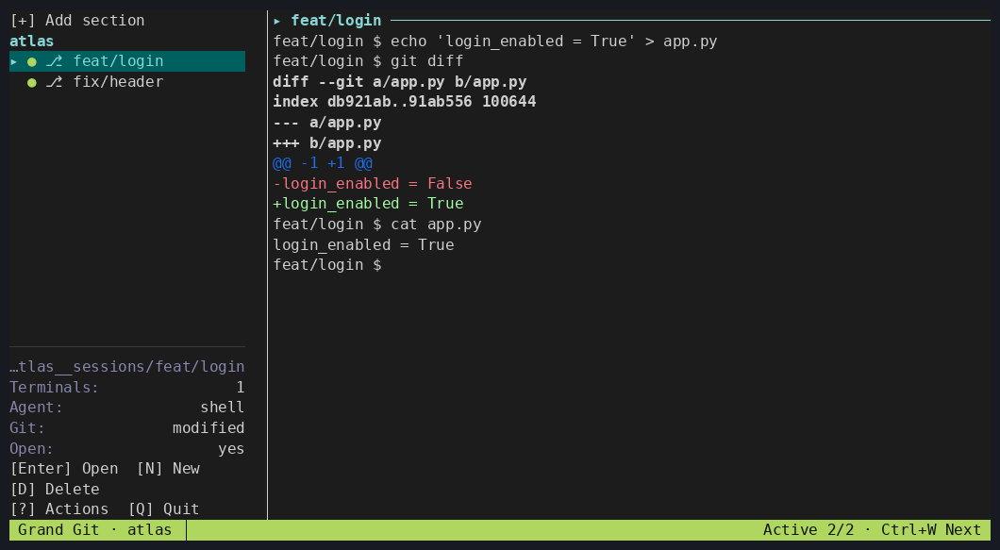

# Grand Git

[English](README.md)

**Простая рабочая среда в терминале: Git worktree, постоянные терминалы, один dashboard.**

Grand Git (`gg`) оставляет повседневный сценарий коротким: создать задачу, поработать в её терминале, переключиться на другую, затем остановить или удалить. Каждая Git-задача получает свой worktree, поэтому незавершённые изменения остаются на месте. Обычные папки тоже поддерживаются — терминалы открываются прямо в них.

Инструмент нужен, когда хочется видеть проекты и запущенные задачи в одном месте с минимумом настройки. По умолчанию открывается shell; шаблоны запуска и статусы Codex подключаются по необходимости. Коммиты, push и merge выполняются привычными Git-инструментами.



Создайте задачу, откройте второй worktree и вернитесь обратно — изменения и терминал останутся на месте. [Скриншот без анимации](docs/assets/gg-demo.png).

## Установка

Для Grand Git доступны готовые сборки под Linux (включая WSL2) и macOS для amd64 и arm64. Для терминальных сессий установите **tmux 3.4+**, а для работы с Git-проектами — **Git 2.31+**. Если устанавливаете v1.0.0, используйте Git 2.36+. Установщик проверяет наличие обоих инструментов. Для Git-задач нужен репозиторий с рабочей копией.

Чтобы установить последний стабильный релиз в `~/.local/bin`, выполните команды ниже.

```sh
curl -fsSLo install-gg.sh https://github.com/chartyom/grand-git/releases/latest/download/install.sh &&
  sh install-gg.sh
export PATH="$HOME/.local/bin:$PATH"
gg --version
```

Для сборки из исходников понадобится **Go 1.26+**. В корне репозитория выполните `go build -o bin/gg ./cmd/gg` и запускайте `./bin/gg`. Установка конкретной версии, ручная загрузка архива, обновление и удаление описаны в [руководстве по установке на английском](docs/installation.md).

Если `gg` открывает Git GUI или сообщает, что команда `gui` отсутствует, проверьте, есть ли в вашей оболочке [алиас `gg`](docs/installation.md#if-gg-runs-git-gui).

## Быстрый старт

```sh
gg dashboard                 # сохранённые разделы-папки и сессии
```

Нажмите +, выберите папку и подтвердите через Ctrl+S. На этом разделе нажмите T для обычного shell или N для создания сессии. В Git-проекте введите имя worktree, например `clone1`, и нажмите Enter. Дерево откроется на текущем коммите без ветки. В его терминале команда `git switch -c feat/login` создаст ветку, а `git switch release` переключит на свободную ветку `release`. Имя строки и папки останется `clone1`. Ctrl+W по кругу переключает список и панели терминалов; Enter открывает выбранную сессию. При переходе в другой проект тот же процесс gg dashboard остаётся открытым.

Создавать задачи можно и из командной строки. Запустите этот пример в рабочей папке Git-репозитория, где в ветке `main` есть хотя бы один коммит.

```sh
gg create clone1             # worktree без ветки и shell в фоне
gg create clone2 --base main
gg create clone3 --branch fix/release
gg list
```

`gg create feat/login` создаёт папку `<проект>__sessions/feat~login`. Уже созданные сессии сохраняют свои пути. Игнорируемые локальные файлы, например `.env` и `node_modules`, независимо копируются; `--no-copy` отключает копирование. Вне Git команда `gg create [name]` создаёт терминал в текущей папке. `gg` без подкоманды показывает справку.

## Dashboard

Сессии сгруппированы по разделам-папкам. Worktree-сессии (`⎇`) и обычные терминалы (`>_`) показаны общим списком в порядке создания. Один клик открывает или запускает сессию; наведение показывает подробности без переключения терминала. `●` / `○` означает работающий / остановленный терминал; `▸` отмечает открытый терминал независимо от выделенной строки. Подробности показывают путь, число терминалов, состояния агента и Git.

После подтверждения нового Git-worktree в списке сразу появляется строка с анимацией. Пока копируется `node_modules`, можно работать в другом терминале или выйти через Q. Если остаться на строке, dashboard откроет готовый терминал автоматически. Если переключиться, фокус останется там, где вы работаете.

| Действие в списке | Клавиша |
| --- | --- |
| Выбрать / открыть | ↑↓ или J/K / Enter или один клик |
| Добавить раздел / убрать пустой раздел | + / X |
| Новая сессия | N |
| Включить относительные пути worktree для общего Git-проекта (Git 2.48+ у всех клиентов) | R на разделе-папке |
| Действия и сочетания клавиш | Правая кнопка, ? или Shift+F10 |
| Поиск, если в списке больше 10 сессий | / |
| Все / только активные | A |
| Следующая панель / отменить | Ctrl+W / Esc |
| Выйти из этого dashboard | Q |

На строке сессии T добавляет терминал в работающую сессию или запускает остановленную. S запускает или останавливает сессию, D удаляет незащищённую сессию, запятая открывает настройки. На строке папки S и D запрашивают подтверждение остановки или удаления сессий этого раздела. Порог поиска считается после фильтра активности. Стрелка вниз или Enter применяет запрос, Esc очищает его и выбирает открытый терминал. В узком окне Ctrl+W открывает компактный список после последней панели терминала.

Dashboard запускается с фокусом на списке и без открытого терминала. Он не создаёт сессий и не добавляет папку вызова. Нажмите **+ Добавить раздел**, выберите папку в обзоре или введите путь и подтвердите через **Ctrl+S**. Относительные пути отсчитываются от папки вызова; поддерживаются `~/` и пробелы. Просмотр и отмена ничего не создают. Повторное добавление выделяет существующий раздел.

Каждому разделу соответствует конкретная папка. Например, для `/project` и `/project/src` можно создать отдельные разделы в одном Git-репозитории. На строке папки T открывает постоянный терминал именно в ней. `gg create` добавляет сессию в раздел той папки, откуда вызвана команда. X убирает раздел, когда в нём нет ни работающих, ни остановленных сессий.

Нажмите Q в списке, чтобы закрыть dashboard. Постоянные терминалы продолжат работу. Чтобы вернуться к ним, снова запустите `gg dashboard`.

## Остановка и удаление

```sh
gg stop clone1           # остановить процессы, сохранить worktree и запись
gg start clone1          # открыть новый терминал
gg delete clone1 --yes   # удалить worktree, сохранить Git-ветки
```

Изменённые и обычные неотслеживаемые файлы блокируют удаление без явного `--force`; игнорируемые файлы удаляются с worktree задачи. Если текущий коммит дерева без ветки отсутствует в истории веток и тегов, удаление тоже потребует `--force`. Сохранить коммит можно через `git switch -c <ветка>` в этом дереве. Исходные и внешние worktree через `gg` не удаляются. Удаление сессии обычной папки сохраняет все её файлы. Перед массовыми операциями прочитайте [правила защиты](docs/usage.md#lifecycle-and-safeguards).

## Альтернативы

| Инструмент | Для чего подходит |
| --- | --- |
| [Git worktree](https://git-scm.com/docs/git-worktree) + [tmux](https://github.com/tmux/tmux) | Прямое управление worktree и терминалами с ручной организацией. |
| [Worktrunk](https://worktrunk.dev/) | CLI для worktree, переключения веток, hooks и сценариев merge. |
| [workmux](https://workmux.dev/guide/) | Worktree вместе с окнами терминала, автоматизацией подготовки, merge и очистки. |

Grand Git сосредоточен на простом управлении сессиями и общем dashboard для Git-проектов и обычных папок. Начните с shell; дополнительные команды запуска подключайте по необходимости.

## Подробнее

- [Справочник на английском](docs/usage.md) описывает глобальные ID, настройки, навигацию, JSON и интеграцию с Codex.
- [Руководство по шаблонам на английском](docs/templates.md) содержит примеры запуска shell, Codex, Claude и своих команд.
- В [репозитории проекта](https://github.com/chartyom/grand-git) также доступны скилл для агента (`docs/skills/grand-git/SKILL.md`), правила разработки (`AGENTS.md`) и спецификации (`openspec/`).

Проверки разработки: `sh scripts/test.sh` и `sh scripts/check-specs.sh`. Тесты используют временные репозитории и изолированные tmux-серверы; проверке спецификаций нужны Node.js 22.12+ и закреплённая версия через npx.
